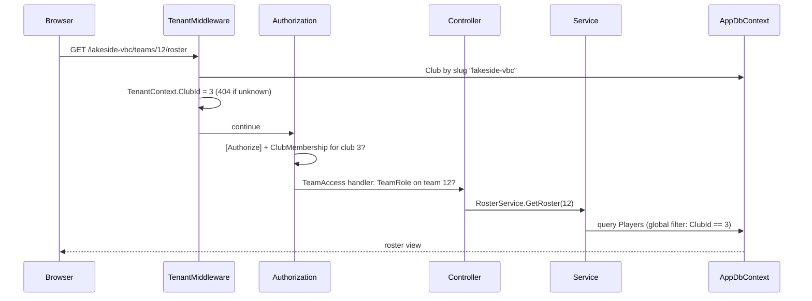

# Architecture

## Solution layout

```
VolleyballTeam.slnx
src/
  VolleyballTeam.Domain/          Entities, enums, BaseModel / TenantModel. Depends only on
                                  Microsoft.Extensions.Identity.Stores (for AppUser).
  VolleyballTeam.Infrastructure/  AppDbContext, EF configurations, migrations, TenantContext,
                                  services (Roster, Schedule, PracticePlan, Announcement),
                                  BlobStorageService, EmailService
  VolleyballTeam.Web/             ASP.NET Core MVC: controllers, view models, Razor views, Tailwind
  VolleyballTeam.Mcp/             (Phase 4) MCP tools hosted in Web; reuse Infrastructure services
tests/
  VolleyballTeam.Tests/           xUnit integration tests (tenant isolation, services, endpoints)
```

Business logic lives in **services in Infrastructure**, not in controllers. Controllers translate between HTTP and view models. This lets the future MCP tools call the same services, with the same tenant rules, as the web UI.

Services are concrete classes registered directly in DI. Interfaces are added only where there are genuinely two implementations ([CONVENTIONS.md](CONVENTIONS.md)).

## Multi-tenancy

Shared database, one `ClubId` column per tenant-owned table ([ADR 0004](adr/0004-shared-database-multi-tenancy.md)). The tenant comes from the URL ([ADR 0006](adr/0006-tenant-resolution-by-route-slug.md)).

### Request flow



### Enforcement layers

1. **Read side:** an EF Core global query filter `e => e.ClubId == _tenant.ClubId` is applied to every `TenantModel` type, configured in one loop in `OnModelCreating`. A forgotten `Where` can't leak rows.
2. **Write side:** a `SaveChangesInterceptor` sets `ClubId` on added entities and throws if a modified or added entity's `ClubId` doesn't match the current tenant.
3. **Database keys:** child rows reference their parent by `(ClubId, ParentId)` against an alternate key on the parent. For example, a `TeamMembership` can only point at a team in its own club, and SQL Server itself rejects anything else.
4. **Authorization:** `[Authorize]` on controllers, a club-membership requirement, and resource-based handlers for team access using `TeamRole`.
5. **Tests:** seed two clubs, then assert through services *and* HTTP endpoints that club A never sees, edits or deletes club B's data. These run in CI on every push.

`IgnoreQueryFilters()` is allowed only in tenant resolution and platform-admin code, and every use is covered by a test.

Club slugs are lowercase and URL-safe, and top-level route names (`account`, `error`, `admin`…) are reserved, so a club can never shadow an app route (`ClubSlug` and the `clubslug` route constraint).

EF Core's SQL Server retry strategy is enabled, so requests survive the free-tier database resuming from auto-pause.

## Front end

- Razor views styled with **Tailwind CSS**, built with the Tailwind standalone CLI at build time and in CI. No CDN.
- Third-party JS/CSS (DataTables 2.x and others) is vendored under `wwwroot/lib/`.
- Index pages use DataTables with **server-side processing over POST** and sorting by named fields.
- Club branding: the layout sets CSS custom properties (`--club-primary`, `--club-secondary`) from the current `Club`, and Tailwind utilities reference them.
- A shared confirmation modal replaces browser `alert`/`confirm`.

## Cross-cutting services

| Service | Responsibility |
|---|---|
| `TenantContext` | Scoped; holds current `ClubId`, slug, time zone, branding |
| `BlobStorageService` | Uploads to a private container; mints 15-minute read-only SAS URLs (with `rscd`/`rsct`) for redirects |
| `EmailService` | Renders Razor email views to strings and sends via Azure Communication Services |
| `RazorViewRenderer` | Reusable view-to-string rendering for emails |

Config follows the Options pattern: `Config/<Service>Options.cs` bound from a root-level `appsettings.json` section, with SDK clients registered as singletons that are built lazily.

## Testing

- **xUnit** integration tests against a real SQL Server (LocalDB locally; a SQL Server container in CI), so query filters and string-enum conversions behave as they will in production.
- `WebApplicationFactory` for endpoint-level authorization and isolation tests.

## Deployment

GitHub Actions: restore → Tailwind build → build → test → publish → deploy to Azure App Service. Migrations are generated and applied by the developer, not by CI or at app startup. See [ADR 0007](adr/0007-low-cost-azure-hosting.md).
