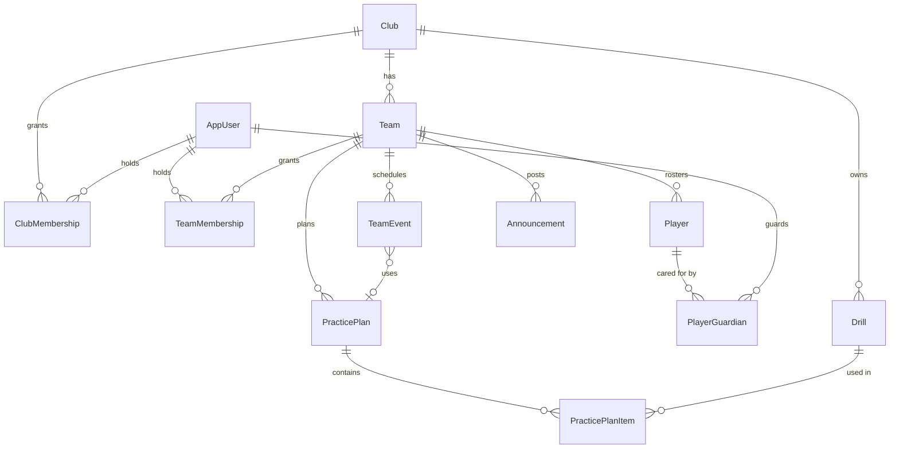

# Domain Model

## Glossary

| Term | Meaning |
|---|---|
| **Club** | The tenant. An organization that owns teams and the club's branding. Every tenant-owned row carries a `ClubId`. |
| **Team** | A group of players within a club for one season (e.g. "16 Black, 2026–27"). Teams share almost nothing with each other. |
| **Member** | A user with access to a club (`ClubMembership`) and, separately, to specific teams (`TeamMembership`). |
| **Guardian** | A parent or guardian user linked to one or more players. |
| **Event** | Anything on a team's schedule: practice, game, tournament, other. |
| **Drill** | A reusable practice activity in the club-wide library. |
| **Practice plan** | An ordered list of drills with durations, optionally attached to a practice event. |
| **Announcement** | A team update that is also emailed to the team's guardians. |

## Base types

Every entity extends `BaseModel`:

```csharp
public abstract class BaseModel
{
    public int Id { get; set; }
    public DateTime CreatedAt { get; set; }
    public DateTime UpdatedAt { get; set; }
}

public abstract class TenantModel : BaseModel
{
    public int ClubId { get; set; }
}
```

Enums are stored as strings (`HasConversion<string>()`). All `DateTime`s are UTC; they are converted to the club's time zone for display.

## Entities



| Entity | Base | Key fields |
|---|---|---|
| `Club` | `BaseModel` | Name, Slug (unique, URL-safe), LogoBlobPath, PrimaryColor, SecondaryColor, TimeZoneId |
| `Team` | `TenantModel` | Name, Season, AgeGroup, Level |
| `AppUser` | `IdentityUser<int>` | FirstName, LastName |
| `ClubMembership` | `TenantModel` | UserId, `ClubRole` |
| `TeamMembership` | `TenantModel` | UserId, TeamId, `TeamRole` |
| `Player` | `TenantModel` | TeamId, FirstName, LastName, JerseyNumber, PrimaryPosition, SecondaryPosition, GradYear |
| `PlayerGuardian` | `TenantModel` | PlayerId, UserId, Relationship |
| `TeamEvent` | `TenantModel` | TeamId, `EventType`, StartUtc, EndUtc, Location, Opponent, Notes, PracticePlanId? |
| `Drill` | `TenantModel` | Name, Description, `SkillFocus`, DurationMinutes, MinPlayers, MaxPlayers, Equipment, `Intensity` |
| `PracticePlan` | `TenantModel` | TeamId, Title, Focus, `PlanStatus` |
| `PracticePlanItem` | `TenantModel` | PracticePlanId, DrillId, SortOrder, DurationMinutes, Notes |
| `Announcement` | `TenantModel` | TeamId, Title, Body, PublishedAt, EmailedAt? |
| `EventRsvp` *(Phase 3)* | `TenantModel` | TeamEventId, PlayerId, `RsvpStatus`, Attended? |
| `GameResult` / `SetScore` *(Phase 3)* | `TenantModel` | TeamEventId, SetNumber, OurScore, TheirScore |

`ClubId` is denormalized onto child rows such as `PracticePlanItem`, so that every tenant-owned table can be filtered directly without joins ([ADR 0004](adr/0004-shared-database-multi-tenancy.md)).

## Enums

| Enum | Values |
|---|---|
| `ClubRole` | Owner, Admin, Member |
| `TeamRole` | HeadCoach, AssistantCoach, TeamManager, Parent |
| `Position` | Setter, OutsideHitter, MiddleBlocker, Opposite, Libero, DefensiveSpecialist |
| `EventType` | Practice, Game, Tournament, Other |
| `SkillFocus` | Serving, Passing, Setting, Attacking, Blocking, Defense, Transition, Conditioning, TeamPlay |
| `Intensity` | Low, Medium, High |
| `PlanStatus` | Draft, Published |
| `RsvpStatus` | Yes, No, Maybe, NoResponse |

## Roles and permissions

Club Owners and Admins can do everything within their club. For team data, the user's `TeamRole` on that team decides what they can do:

| Action | HeadCoach | AssistantCoach | TeamManager | Parent |
|---|:-:|:-:|:-:|:-:|
| View roster | ✅ | ✅ | ✅ | ✅ (names, numbers, positions) |
| Edit roster | ✅ | ✅ | ✅ | ❌ |
| View schedule | ✅ | ✅ | ✅ | ✅ |
| Edit schedule | ✅ | ✅ | ✅ | ❌ |
| View / edit practice plans | ✅ | ✅ | view only | ❌ |
| Post announcements | ✅ | ✅ | ✅ | ❌ |
| Invite members | ✅ | ❌ | ✅ (parents only) | ❌ |
| RSVP *(Phase 3)* | — | — | — | ✅ (own players only) |

All club members can view the drill library; coaches add drills and edit their own.
