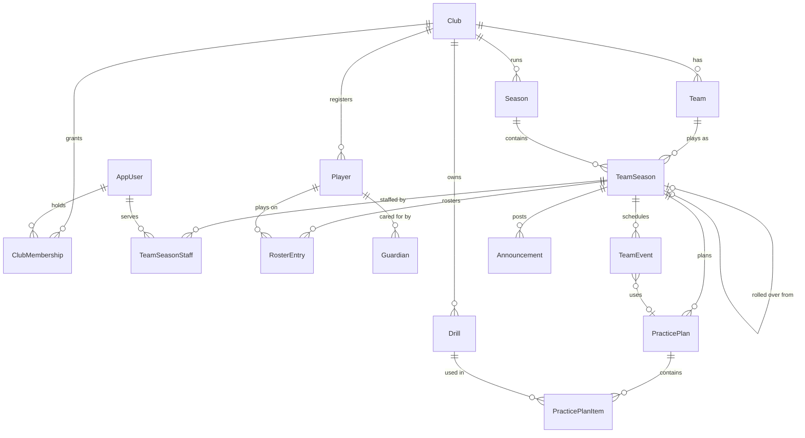

# Domain Model

## Glossary

| Term | Meaning |
|---|---|
| **Club** | The tenant. An organization that owns teams and the club's branding. Every tenant-owned row carries a `ClubId`. |
| **Season** | A club-wide year (e.g. 2026-27): Upcoming, Active or Archived. Admins start and archive seasons. |
| **Team** | A team's lasting identity (e.g. "Black"). It carries history from season to season. |
| **Team season** | A team in one season (e.g. "16U Black, 2026-27"): its name, age group, level, staff, roster, schedule and announcements. |
| **Rollover** | Creating next season's team season from this one, optionally renamed, moved up an age group, and with chosen staff. |
| **Staff** | A coach or team manager assigned to a team season. |
| **Member** | A user with access to a club (`ClubMembership`). |
| **Player** | A club-level record of a child, so the same player carries across seasons. Players never log in. |
| **Guardian** | A parent or guardian contact on a player. In Phase 1 guardians receive emails but don't log in ([ADR 0013](adr/0013-guardians-as-contacts.md)). |
| **Event** | Anything on a team season's schedule: practice, game, tournament, other. |
| **Drill** | A reusable practice activity in the club-wide library. |
| **Practice plan** | An ordered list of drills with durations, optionally attached to a practice event. |
| **Announcement** | A team season update that is also emailed to its guardians and staff. |

## Base types

Every entity extends `BaseModel`; tenant-owned entities extend `TenantModel`:

```csharp
public abstract class BaseModel
{
    public int Id { get; set; }
    public DateTime CreatedAt { get; set; }
    public DateTime UpdatedAt { get; set; }
    public DateTime? DeletedAt { get; set; }   // soft delete, ADR 0011
    public int? CreatedById { get; set; }
    public int? UpdatedById { get; set; }
    public int? DeletedById { get; set; }
}

public abstract class TenantModel : BaseModel
{
    public int ClubId { get; set; }
}
```

Enums are stored as strings. All `DateTime`s are UTC; they are converted to the club's time zone for display.

## Entities



| Entity | Base | Key fields |
|---|---|---|
| `Club` | `BaseModel` | Name, Slug (unique, URL-safe), LogoBlobPath, PrimaryColor, SecondaryColor, TimeZoneId |
| `AppUser` | `IdentityUser<int>` | FirstName, LastName, DeactivatedAt |
| `ClubMembership` | `TenantModel` | UserId, `ClubRole`, DeactivatedAt |
| `Season` | `TenantModel` | Name, StartsOn?, EndsOn?, `SeasonStatus` |
| `Team` | `TenantModel` | Name |
| `TeamSeason` | `TenantModel` | TeamId, SeasonId, DisplayName, AgeGroup, Level, RolledOverFromId? |
| `TeamSeasonStaff` | `TenantModel` | TeamSeasonId, UserId, `StaffRole` |
| `Player` | `TenantModel` | FirstName, LastName, GradYear? |
| `Guardian` | `TenantModel` | PlayerId, FirstName, LastName, Email, Relationship, UnsubscribedAt?, UnsubscribeToken |
| `RosterEntry` | `TenantModel` | TeamSeasonId, PlayerId, JerseyNumber, PrimaryPosition, SecondaryPosition?, JoinedOn, LeftOn? |
| `TeamEvent` *(slice 4)* | `TenantModel` | TeamSeasonId, `EventType`, StartUtc, EndUtc, Location, Opponent?, Notes? |
| `Announcement` *(slice 5)* | `TenantModel` | TeamSeasonId, Title, Body, PublishedAt, EmailedAt?, RecipientCount |
| `Invitation` | `TenantModel` | Email, TokenHash, ExpiresAt, AcceptedAt?, `ClubRole`, TeamSeasonId?, `StaffRole`? |
| `Drill` *(Phase 2)* | `TenantModel` | Name, Description, `SkillFocus`, DurationMinutes, MinPlayers, MaxPlayers, Equipment, `Intensity` |
| `PracticePlan` *(Phase 2)* | `TenantModel` | TeamSeasonId, Title, Focus, `PlanStatus` |
| `PracticePlanItem` *(Phase 2)* | `TenantModel` | PracticePlanId, DrillId, SortOrder, DurationMinutes, Notes |
| `EventRsvp` *(Phase 3)* | `TenantModel` | TeamEventId, PlayerId, `RsvpStatus`, Attended? |
| `GameResult` / `SetScore` *(Phase 3)* | `TenantModel` | TeamEventId, SetNumber, OurScore, TheirScore |

`ClubId` is denormalized onto child rows so every tenant-owned table can be filtered directly, and children reference parents by `(ClubId, ParentId)` so the database rejects cross-club links ([ADR 0004](adr/0004-shared-database-multi-tenancy.md)).

Nothing is hard-deleted ([ADR 0011](adr/0011-soft-delete-and-deactivation.md)). Removing a player from a roster sets `LeftOn` and keeps the entry.

## Enums

| Enum | Values |
|---|---|
| `ClubRole` | Owner, Admin, Member |
| `SeasonStatus` | Upcoming, Active, Archived |
| `StaffRole` | HeadCoach, AssistantCoach, TeamManager |
| `Position` | Setter, OutsideHitter, MiddleBlocker, Opposite, Libero, DefensiveSpecialist |
| `EventType` | Practice, Game, Tournament, Other |
| `SkillFocus` | Serving, Passing, Setting, Attacking, Blocking, Defense, Transition, Conditioning, TeamPlay |
| `Intensity` | Low, Medium, High |
| `PlanStatus` | Draft, Published |
| `RsvpStatus` | Yes, No, Maybe, NoResponse |

## Roles and permissions

Access to a team season is decided per team season ([ADR 0012](adr/0012-seasons-and-team-history.md)):

| Who | Upcoming / Active season | Archived season |
|---|---|---|
| Club Owner / Admin | Edit | Read-only (an admin can reopen the season) |
| Head coach of that team season | Edit | Read-only, automatically |
| Assistant coach / team manager of that team season | Edit | No access |
| Anyone else, or a deactivated account or membership | No access | No access |

A coach's past seasons stay visible only for the team seasons they coached. They don't get the team's current season once they no longer coach it.

Within a team season the user can edit:

| Action | Owner / Admin | HeadCoach | AssistantCoach | TeamManager |
|---|:-:|:-:|:-:|:-:|
| Edit team season details | ✅ | ✅ | ✅ | ✅ |
| Assign staff | ✅ | ❌ | ❌ | ❌ |
| Edit roster and guardians | ✅ | ✅ | ✅ | ✅ |
| Edit schedule | ✅ | ✅ | ✅ | ✅ |
| Practice plans *(Phase 2)* | ✅ | ✅ | ✅ | view only |
| Post announcements | ✅ | ✅ | ✅ | ✅ |
| Start / archive seasons, roll over teams | ✅ | ❌ | ❌ | ❌ |
| Invite staff | ✅ | ✅ | ❌ | ❌ |

All club members can view the drill library; coaches add drills and edit their own.
